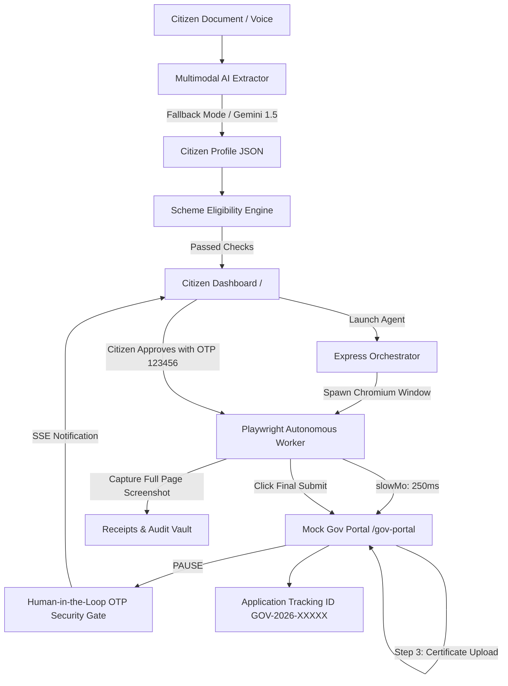

# CivicPulse — Autonomous Public Service & Bureaucracy Execution Agent
> **Track : Civic Pulse, Digital Governance & Public Information — Problem**  
> *An AI-powered agentic system that extracts citizen welfare eligibility from documents or voice, evaluates policy rules, and autonomously executes government application portals live via Playwright with Human-in-the-Loop OTP security.*

---

## 🌟 Executive Summary & Problem Statement

Navigating e-Governance portals in developing economies is fraught with bureaucratic friction:
1. **Linguistic & Accessibility Barriers**: Citizens struggle with complex 30-field forms in unfamiliar bureaucratic jargon.
2. **Document & Eligibility Confusion**: Citizens often do not know whether their household income qualifies them for state vs. central scholarships.
3. **Execution Gap**: Even when citizens qualify, portals require tedious multi-step data entry, certificate attachments, and cascading dropdown selections.
4. **Trust & Security Risks**: Fully autonomous execution without human consent poses severe statutory risks.

**CivicPulse solves this end-to-end**:
- **Multilingual Voice & Text Assistant**: Supports Hindi (`hi-IN`) and English (`en-IN`) speech-to-intent parsing.
- **Multimodal AI Ingestion**: Parses Aadhaar IDs, Income Certificates, and Caste Certificates using Gemini Vision with an offline fallback.
- **Automated Policy Eligibility Engine**: Automatically verifies income ceilings and quota eligibility before initiating government filings.
- **Autonomous Playwright Execution Worker**: Launches a visible browser (`headless: false`, `slowMo: 250ms`) that types, navigates cascading state/district dropdowns, and uploads certificates in real time.
- **Human-in-the-Loop OTP Checkpoint**: Pauses execution at Step 3 right before final submission, requiring the citizen to review details and approve submission via simulated e-Sign OTP on their dashboard.
- **100% Local Reliability**: Includes both the Citizen Command Dashboard (`/`) and a realistic 3-step Mock Government Welfare Portal (`/gov-portal`) so demonstrations run with zero external downtime.

---

## 🏗️ Architecture & Technology Stack



- **Frontend**: React 18, Vite, Tailwind CSS, Lucide Icons, Web Speech API (`webkitSpeechRecognition`).
- **Backend**: Node.js, Express.js, Server-Sent Events (SSE) telemetry stream, Multer.
- **Automation**: Playwright (Node.js Chromium engine, `headless: false`, `slowMo: 250`).
- **Storage**: Dual-mode MongoDB with automated atomic JSON fallback (`server/data/db.json`).
- **AI / LLM**: Multimodal Gemini Vision SDK (`@google/generative-ai`) + Built-in offline fallback parser.

---

## 🚀 Quickstart Guide

### 1. Prerequisites
- Node.js (v18 or higher)
- Google Chrome or Chromium (installed automatically by Playwright)

### 2. Monorepo Installation
```bash
# Install root, client, and server dependencies
cd server
npm install
npx playwright install chromium

cd ../client
npm install
npm run build
cd ..
```

### 3. Configure Environment Variables (Optional)
Create `server/.env` (an example is provided in `server/.env.example`):
```env
PORT=5000
MONGO_URI=mongodb://localhost:27017/civic_agent
GEMINI_API_KEY=your_gemini_api_key_here
```
> **Note**: An API key is **not required** for judging or local testing. If omitted, CivicPulse automatically engages its **Smart Offline Fallback Engine** to guarantee 100% demo uptime.

### 4. Start the Application
Run the unified Express server (which serves both backend API and the compiled frontend):
```bash
node server/server.js
```
Open your browser to:
- **Citizen Command Dashboard**: [http://localhost:5000/](http://localhost:5000/)
- **Target Government Portal**: [http://localhost:5000/gov-portal](http://localhost:5000/gov-portal)

*(Alternatively, run Vite dev server in client folder: `cd client && npm run dev` on port 5173).*

---

## 🧪 Automated End-to-End Test (One-Click Verification)

To execute an automated end-to-end verification that starts the agent, fills the portal in a visible Chromium browser, pauses for Human-in-the-Loop OTP approval, submits, and verifies the captured receipt:
```bash
node server/test-e2e.js
```

---

## ⏱️ 3-Minute Hackathon Demo Script for Judges

| Timing | Screen | Spoken Pitch & Demonstration Action |
| :--- | :--- | :--- |
| **0:00 – 0:35** | **Citizen Dashboard (`/`)** | *"Judges, millions of eligible citizens miss out on government welfare schemes because e-governance portals are complex, jargon-heavy, and unforgiving. Meet CivicPulse — an autonomous public service agent that bridges this bureaucratic divide."*<br>👉 Show multilingual voice mic: speak *"Mera scholarship form bhar do"* or click the quick prompt preset. |
| **0:35 – 1:10** | **Document & Eligibility** | *"A student uploads their income certificate or clicks our one-click sample certificate loader. Watch how our multimodal extractor immediately structures their legal identity, Aadhaar number, and bank credentials. Concurrently, our rule engine evaluates whether their family income meets the threshold, giving a plain-language explanation in both English and Hindi."* |
| **1:10 – 2:05** | **Live Playwright Execution** | *"Now we click 'Launch Autonomous Playwright Agent'. Notice that we don't mock the automation: a real, visible Chromium browser opens on screen with slow-motion typing. The AI fills personal details, handles cascading state and district dropdowns, declares scheme benefits, and attaches the income certificate."* |
| **2:05 – 2:35** | **Human-in-the-Loop Checkpoint** | *"Notice that the agent does NOT recklessly submit. It stops right before the final button. On our dashboard, a security approval modal alerts the citizen with a summary of the extracted data. Only when the citizen reviews and enters their e-Sign OTP (123456) does the agent execute the final submission."* |
| **2:35 – 3:00** | **Receipt & Audit Trail Vault** | *"The portal generates an official Application Tracking ID (`GOV-2026-XXXXX`). Our agent captures a full-page receipt screenshot and commits it to the persistent Audit Vault. Bureaucracy executed in 60 seconds without errors."* |

---

## 🛡️ Key Safety & Reliability Features

1. **Human-in-the-Loop by Design**: The agent cannot trigger final form submission without a signed token from the citizen dashboard.
2. **Zero External Portal Dependency**: Includes a realistic mock government portal (`/gov-portal`) modeled after Indian e-Governance portals, eliminating demo failures from CAPTCHAs or live site downtimes.
3. **Graceful Storage Degradation**: Automatically falls back to an atomic local JSON database (`server/data/db.json`) if MongoDB is unavailable.
4. **Smart Offline Fallback Engine**: Always functions reliably even without internet or when API quotas are exceeded.

---

## 📄 License
MIT License. Created for Hackathon Track 1: Civic Pulse, Digital Governance & Public Information.
